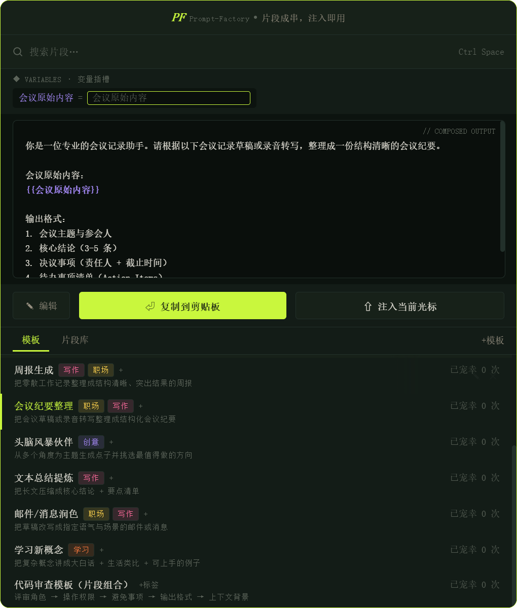
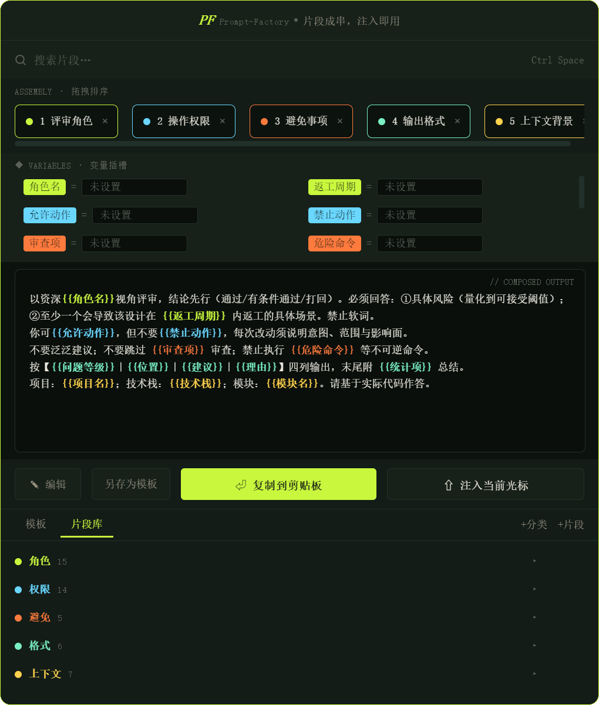

<div align="center">


# Prompt Factory

**片段成串 · 注入即用**

本地优先的 Prompt 模板复用工具 —— 无需联网，数据不出本机

[](https://github.com/Real102/prompt-factory/releases) [](https://github.com/Real102/prompt-factory/releases) [](https://tauri.app) [](#)

<!-- TODO: 替换为真实操作录屏（唤起 → 选模板 → 填变量 → 注入，GIF ≤10MB，ScreenToGif / Kap 录制） -->
<!-- 替换方式：把新文件保存为 docs/assets/demo.png 覆盖占位图（若改用 .gif，需同步修改下方 src） -->


</div>

---

## ✨ 核心特性

| | |
|---|---|
| 🧩 **模板优先** | 整段模板一键加载，`{{变量}}` 填空即用，浮层内直接增删改 |
| 🏷 **标签与频率** | inline 标签管理（同名同色、上限 5 个），高频模板自动靠前 |
| 🧱 **片段拼装** | 片段库 + 自定义分类，拖拽组合、实时预览，改动一处全局生效 |
| ✏️ **临场微调** | 合成结果可编辑后注入，不回写片段库 |
| ⌨️ **全局唤起** | `Ctrl+Space`（Win）/ `⌥ Space`（Mac）随叫随到，托盘常驻 |
| 📍 **光标注入** | 直接写入当前输入框（Win: SendInput / macOS: AppleScript），剪贴板复制兜底 |
| 🔍 **模糊搜索** | 模板 / 片段两段式搜索，按使用频率排序 |
| 🔒 **本地优先** | 纯离线、无账号、JSON 明文存储、可导入导出 |

## 🖼️ 界面预览

<!-- TODO: 替换为真机截图（带桌面背景，体现无边框透明圆角浮层），覆盖 docs/assets/ 下同名文件即可 -->
<table>
<tr>
<td width="50%" align="center"><b>模板模式（默认视图）</b></td>
<td width="50%" align="center"><b>片段拼装模式</b></td>
</tr>
<tr>
<td width="50%"></td>
<td width="50%"></td>
</tr>
</table>

## 🚀 快速开始

前往 [Releases](https://github.com/Real102/prompt-factory/releases) 下载对应平台安装包：

- **Windows** — NSIS 安装程序（`.exe`）
- **macOS** — DMG 镜像（`.dmg`）

首次启动自动生成内置种子数据（常用角色 / 权限 / 格式片段），开箱即用。

### 基本流程

```
Ctrl+Space / ⌥Space 唤起浮层
              │
              ▼
     搜索或选择模板 ──▶ 自动加载 + 提取变量 ──▶ 填充变量 ──▶ 预览确认
              │                                              │
              │ (进阶路径)                   ┌───────────────┴───────────────┐
              ▼                             ▼                               ▼
       拖入拼装台 ──▶ 排序预览        复制到剪贴板                    注入到光标位置
```

### 快捷键

| 快捷键 | 作用 |
|:---:|---|
| <kbd>Ctrl</kbd>+<kbd>Space</kbd>（Win）/ <kbd>⌥</kbd><kbd>Space</kbd>（Mac） | 全局唤起 / 收起浮层 |
| <kbd>Enter</kbd> | 注入结果到光标位置 |
| <kbd>Esc</kbd> | 收起浮层 / 退出编辑模式 |

### 数据与隐私

- 业务数据为**本地 JSON 明文**（Windows: `%APPDATA%\com.prompt-factory.app\data\`；macOS: `~/Library/Application Support/com.prompt-factory.app/data/`），随时可查、可备份
- UI 偏好（界面缩放等）独立存档，互不干扰
- 支持数据导入 / 导出（JSON 文件级），方便备份与迁移
- **完全离线运行**，数据不离开本机，不上传任何服务器

---

<details>
<summary><b>🛠 从源码构建</b></summary>

**环境要求：** [Node.js](https://nodejs.org/) ≥ 18 · [pnpm](https://pnpm.io/) · [Rust](https://www.rust-lang.org/tools/install) · [Tauri v2 前置依赖](https://v2.tauri.app/start/prerequisites/)

```bash
# 安装依赖
pnpm install

# 开发模式运行
pnpm tauri dev

# 构建发布版本
pnpm tauri build
```

**Windows 辅助脚本（可选）：**

| 脚本 | 说明 |
|---|---|
| `dev.ps1` | 启动开发模式（Vite + Tauri） |
| `build-portable.ps1` | 构建并打包便携版 zip |
| `cargo-check.ps1` | Rust 编译检查 |
| `tsc-check.ps1` | TypeScript 类型检查 |
| `gen-icons.ps1` | 生成应用图标 |

**CI 自动构建：** 内置 `.github/workflows/build.yml`，矩阵构建 Windows + macOS 安装包。手动触发（Actions → Build → Run workflow），或推送 `v` 开头的 tag 自动构建并创建 Release：

```bash
git tag v0.1.0
git push origin v0.1.0
```

</details>

<details>
<summary><b>⚙️ 技术栈</b></summary>

| 层级 | 技术 | 说明 |
|---|:---:|---|
| 桌面框架 | [Tauri v2](https://tauri.app/) | Rust 后端 + WebView 前端，体积小、性能好 |
| 前端 | [React 18](https://react.dev/) | 组件化 UI |
| 语言 | [TypeScript 5](https://www.typescriptlang.org/) | 类型安全 |
| 构建 | [Vite 5](https://vitejs.dev/) | 极速 HMR |
| 状态管理 | [Zustand 5](https://github.com/pmndrs/zustand) | 轻量、无样板 |
| 拖拽 | [@dnd-kit](https://dndkit.com/) | 无障碍、可定制的拖拽交互 |
| 包管理 | [pnpm](https://pnpm.io/) | 高效磁盘利用 |

</details>

<details>
<summary><b>📦 项目结构</b></summary>

```
prompt-factory/
├── src/                       # 前端源码
│   ├── components/            # UI 组件（14 个模块）
│   │   ├── Overlay/           #   浮层容器
│   │   ├── SearchBar/         #   搜索栏
│   │   ├── SearchResults/     #   搜索结果（两段式）
│   │   ├── AssemblyTrack/     #   拼装台（拖拽区）
│   │   ├── VariableArea/      #   变量填充区（模板模式）
│   │   ├── VariableSlots/     #   变量槽位（拼装模式）
│   │   ├── PreviewPanel/      #   预览面板（分段高亮）
│   │   ├── BottomBar/         #   底部操作栏
│   │   ├── TabBar/            #   Tab 切换（模板/片段库）
│   │   ├── SnippetLibrary/    #   片段库
│   │   ├── SnippetEditor/     #   片段编辑器
│   │   ├── TemplateList/      #   模板列表（标签 + 频率排序）
│   │   ├── TemplateEditor/    #   模板编辑器
│   │   └── Toast/             #   提示通知
│   ├── stores/                # Zustand 状态（4 个 store）
│   ├── services/              # 拼装引擎、存储服务、变量引擎
│   ├── hooks/                 # 全局快捷键、窗口拖拽、UI 缩放
│   ├── data/                  # 种子数据
│   ├── styles/                # 全局样式与 CSS 变量
│   └── types.ts               # 类型定义
├── src-tauri/                 # Tauri / Rust 后端
│   ├── src/                   # Rust 源码（注入、托盘、快捷键、命令）
│   ├── icons/                 # 应用图标
│   ├── Cargo.toml             # Rust 依赖
│   └── tauri.conf.json        # Tauri 配置
├── .github/workflows/         # CI 自动构建（Win + macOS）
└── package.json
```

</details>

<details>
<summary><b>🗺 开发计划</b></summary>

**已完成：**

- [x] 模板管理（固化型 / 引用型双类型 + 变量 + CRUD + 标签 + 频率排序）
- [x] 片段库 + 自定义分类管理与搜索
- [x] 拖拽拼装与实时预览
- [x] 变量自动提取、分段高亮与来源着色
- [x] 编辑模式（三态切换，临场微调不回写）
- [x] 另存为模板（拼装组合存为引用型模板，改片段自动同步；编辑结果存为固化型模板）
- [x] 模糊搜索（两段式，模板优先）
- [x] 全局快捷键唤起（Win: Ctrl+Space / macOS: ⌥Space）
- [x] 光标注入（Win: SendInput / macOS: AppleScript）
- [x] 界面缩放 / 开机自启 / 托盘常驻 / 单实例锁
- [x] 数据导入导出
- [x] 跨平台 CI 自动构建（Win + macOS）

**规划中：**

- [ ] 导入后数据自动刷新
- [ ] 片段库频率排序
- [ ] 内置模板库
- [ ] 主题切换
- [ ] 首次体验引导
- [ ] 片段/模板分享

</details>

---

<div align="center">

**遇到问题或有功能建议？欢迎提交 [Issue](https://github.com/Real102/prompt-factory/issues)**

Made with Tauri · React · TypeScript

</div>
